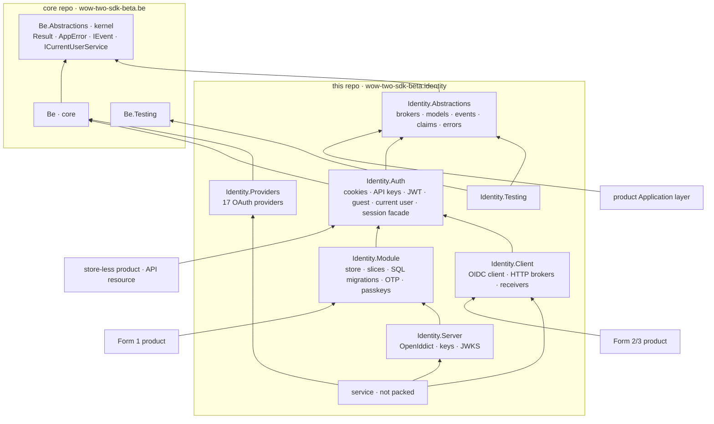

# wow-two-sdk-beta.identity — Architecture

*Last updated: 2026-10-26*

> One broker contract, seven packages, one service that hosts the Form 1 module. Contract as built:
> [contract.md](contract.md); packages and consumers: [package-registry.md](package-registry.md); evidence:
> [T7 library architecture](../research/identity-analysis-2026-10/t7-library-architecture.md).

## Forms map

```
product Domain / Application ──► Abstractions (the contract)
product composition root ──► Module (Form 1)  or  Client (Forms 2/3)
service/Identity.Api ──► Module + Server + Providers (ProjectReference) + HTTP mirror + hosted pages (apps/web)
Client ──OIDC + HTTP──► service/Identity.Api ──► Module ──► the instance's database
```

| Form | Registration | Store owner | Sign-in UI |
|---|---|---|---|
| 1 · library | one registration, `Identity:Mode = Module`, plus the `Module` package | the consumer's database, schema `identity` | `fe-identity` components on the product's origin |
| 2 · self-hosted | the same registration, `Identity:Mode = Oidc`, plus the `Client` package | the consumer's own instance | the instance's hosted pages |
| 3 · provided | as Form 2, pointed at the central instance | the central instance | the instance's hosted pages |

- the registration shape is proposed (Q2): a shared `IdentityMode` enum in Abstractions, options bound from
  configuration and overridable in code; working names `AddIdentityIntegration` and `MapIdentitySession` (T7).
- both modes map the same session routes (`/api/identity/*`), emit the same claims, expose the same brokers and
  raise the same `IEvent` records, so product code never knows the form.
- a configured mode whose package is absent fails at startup with a named error.
- a Form 1 → 3 move deletes the Module line and package and adds the Client; product logic stays untouched.

---

## Package graph

Arrows read "references"; every product also references core.



| Layer | Package | May reference |
|---|---|---|
| contract | `Abstractions` | the kernel only; no framework reference, no third-party package |
| edge | `Auth` | contract, core |
| forms | `Module` · `Client` | edge, contract, core |
| extension | `Providers` · `Server` | forms or core |
| test kit | `Testing` | contract, `WoW2.Sdk.Beta.Be.Testing` |
| service | `service/Identity.Api` | any package above, by `ProjectReference` |
| fe | `@wow-two-beta/fe-identity` | peers `@wow-two-beta/fe` and `vue`; exports `./contracts`, `./kit`, `./admin` |

- core and the kernel never reference an Identity package; another domain references `Identity.Abstractions` only.
- a Form 3 product pulls none of OpenIddict, Fido2, Otp.NET, Argon2, Telegram.Bot or the OAuth set.
- today the code tree holds the template's `Abstractions`, `Module`, `Client` and `Testing` with a sample broker;
  `Auth`, `Providers` and `Server` arrive with the move out of the be sdk.

---

## Service

- hosts the Module with the Server and Providers; it adds hosting, the HTTP mirror of the contract, the hosted pages
  and the admin console, and nothing else.
- serves `apps/web` from the same origin: hosted sign-in, account and console pages on `fe-identity`'s exports; the
  console composes the `./admin` screens.
- two sites per instance: a public one for the protocol, sign-in and account paths, and a private one for the console
  and the admin API; admin routes also check the host.
- owns one database per instance with the `identity` schema; production migrations run as an explicit deploy step.
- every instance is built to run as several replicas: durable stores in PostgreSQL, singleton jobs behind advisory
  locks; it starts as one container.
- the OpenID Foundation conformance suite and the broker conformance suite run against the released image.

---

## Schema

- one linear SQL migration set in the Module creates the whole `identity` schema whatever the configuration; a
  feature that is off neither reads nor writes its tables.
- tables keep the `identity_` prefix inside the `identity` schema, so SQLite (no schemas) and PostgreSQL share names.
- keys are `uuid` made as Guid v7 in code; products key their own data on `sub`, never on a foreign key into Identity.
- never two instances on one identity schema: a database per instance by default, a schema per instance allowed.
- evidence and the table inventory: [T10](../research/identity-analysis-2026-10/t10-schema-migrations.md).
