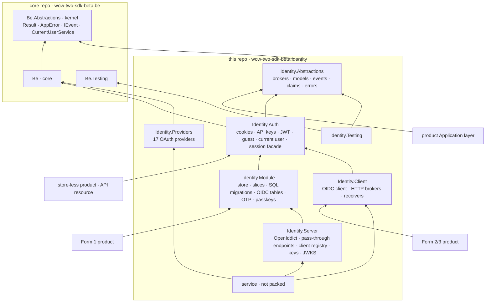

# wow-two-sdk-beta.identity — Architecture

*Last updated: 2026-10-27*

> One broker contract, seven packages, one service that hosts the Form 1 module. Contract as built:
> [contract.md](contract.md); packages and consumers: [package-registry.md](package-registry.md); evidence:
> [T7 library architecture](../research/identity-analysis-2026-10/t7-library-architecture.md).

## Forms map

```
product Domain / Application ──► Abstractions (the contract)
product composition root ──► Module (Form 1)  or  Client (Forms 2/3)
service/Identity.Api ──► Module + Server + Providers (ProjectReference) + HTTP mirror + hosted pages (apps/web)
Client ──OIDC + HTTP──► service/Identity.Api ──► Module ──► the instance's database
```

| Form | Registration | Store owner | Sign-in UI |
|---|---|---|---|
| 1 · library | one registration, `Identity:Mode = Module`, plus the `Module` package | the consumer's database, schema `identity` | `fe-identity` components on the product's origin |
| 2 · self-hosted | the same registration, `Identity:Mode = Oidc`, plus the `Client` package | the consumer's own instance | the instance's hosted pages |
| 3 · provided | as Form 2, pointed at the central instance | the central instance | the instance's hosted pages |

- the registration shape is proposed (Q2): a shared `IdentityMode` enum in Abstractions, options bound from
  configuration and overridable in code; working names `AddIdentityIntegration` and `MapIdentitySession` (T7).
- both modes map the same session routes (`/api/identity/*`), emit the same claims, expose the same brokers and
  raise the same `IEvent` records, so product code never knows the form.
- a configured mode whose package is absent fails at startup with a named error.
- a Form 1 → 3 move deletes the Module line and package and adds the Client; product logic stays untouched.

---

## Package graph

Arrows read "references"; every product also references core.



| Layer | Package | May reference |
|---|---|---|
| contract | `Abstractions` | the kernel only; no framework reference, no third-party package |
| edge | `Auth` | contract, core |
| forms | `Module` · `Client` | edge, contract, core |
| extension | `Providers` · `Server` | forms or core |
| test kit | `Testing` | contract, `WoW2.Sdk.Beta.Be.Testing` |
| service | `service/Identity.Api` | any package above, by `ProjectReference` |
| fe | `@wow-two-beta/fe-identity` | peers `@wow-two-beta/fe` and `vue`; exports `./contracts`, `./kit`, `./admin` |

- core and the kernel never reference an Identity package; another domain references `Identity.Abstractions` only.
- a Form 3 product pulls none of OpenIddict, Fido2, Otp.NET, Argon2, Telegram.Bot or the OAuth set; a Form 1 product
  pulls only OpenIddict's dependency-free entity classes, for the OIDC tables its schema carries.
- every package exists: the moved code fills `Auth`, `Module`, `Client` and `Providers`, `Server` carries the OIDC
  provider, and `Testing` stays empty until the contract has brokers.

---

## Service

- hosts the Module with the Server and Providers; it adds hosting, the HTTP mirror of the contract, the hosted pages
  and the admin console, and nothing else.
- the OIDC provider: `AddOidcServer` on the Module's builder turns the instance's store into an OpenID Connect provider
  (OpenIddict 7.7.2, its EF Core stores on `IdentityDbContext`): code + PKCE S256, rotating refresh tokens with an
  absolute lifetime, discovery, JWKS, userinfo and end-session; no implicit, password or client-credentials grant.
- the authorize, token, userinfo and end-session endpoints run in pass-through on the Module: the authorize endpoint
  reads the account API's cookie session (`/api/account/login?useCookies=true`) and sends a person without one to
  `Identity:Server:SignInPath`; one claim mapper writes every token's claims ([contract](contract.md) § Token claims).
- clients come from `Identity:Server:Clients`, seeded idempotently at startup: confidential, first-party, exact URIs,
  their own audience, hashed secrets.
- keys: X.509 certificates in host files behind `ISigningKeySource`; a deployed boot refuses missing or unusable
  certificates and ephemeral keys; the active certificate is picked per token by its dates, so a staged one takes over
  without a deploy ([keys](../codebase/identity.backend-services/packages/Server/Keys/keys.md)).
- serves `apps/web` from the same origin: hosted sign-in, account and console pages on `fe-identity`'s exports; the
  console composes the `./admin` screens.
- two sites per instance: a public one for the protocol, sign-in and account paths, and a private one for the console
  and the admin API; admin routes also check the host.
- owns one database per instance with the `identity` schema; production migrations run as an explicit deploy step.
- every instance is built to run as several replicas: durable stores in PostgreSQL, singleton jobs behind advisory
  locks; it starts as one container.
- the OpenID Foundation conformance suite and the broker conformance suite run against the released image.

---

## Own hosts

An owner runs Identity one of two ways (decided 2026-10-27): it pulls the default image and configures it, or it
composes the packages in a host of its own. Ocharo runs the default image; wow2's own instance gets its own host image
later, in a platform repository.

| Path | For | Takes | Builds |
|---|---|---|---|
| default image | an owner whose needs fit configuration | the `identity` image and its settings | nothing |
| own host | an owner needing code the default lacks | the NuGet family and `@wow-two-beta/fe-identity` | a thin host: the registration, its pages, its extras |

- fits today: every capability is a package (Module, Server, Providers, Auth), feature switches are configuration in
  every form (Q51), and `keys generate` already lives in the Server package.
- before an own host stays thin:
  1. the instance composition in `service/Identity.Api/Configurations/` (sign-in cookie, Data Protection ring, account
     API, server endpoints, readiness) becomes one package-level call;
  2. the `migrate` command's exit codes move to the be sdk helper the Wheelhouse migrate-step spec names;
  3. `apps/web` stays a thin composition of `fe-identity`'s `./kit` and `./admin`, so an own host builds its pages
     from the same exports;
  4. the host CLI (`admin create`, a one-time sign-in) joins `keys generate` in a package, not the service.

---

## Schema

- one linear SQL migration set in the Module creates the whole `identity` schema whatever the configuration; a
  feature that is off neither reads nor writes its tables.
- the set ships per dialect (`Migrations/Postgres/`, `Migrations/Sqlite/`) and runs as the be sdk named set `identity`,
  with its own history and lock; the Module's `IdentityDbContext` maps it with every name pinned and never generates it.
- tables keep the `identity_` prefix inside the `identity` schema (`Identity:Database:Schema`), so SQLite (no schemas)
  and PostgreSQL share names; `001-accounts` creates the 11 account tables, `002-oidc` OpenIddict's four
  `identity_oidc_*` tables, present in every form and used only by the Server.
- the set claims its schema with an owner kind: `module` in a Form 1 product, `service` in an instance, which migrates
  through `Identity.Api migrate`.
- keys are `uuid` made as Guid v7 in code, claim rows a `bigint` identity; products key their own data on `sub`, never
  on a foreign key into Identity.
- never two instances on one identity schema: a database per instance by default, a schema per instance allowed.
- evidence and the table inventory: [T10](../research/identity-analysis-2026-10/t10-schema-migrations.md).
